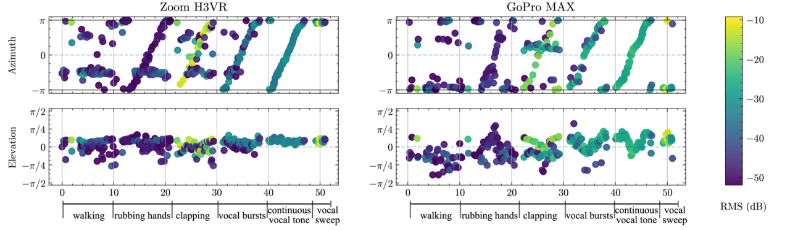

# ambiviz

[](https://github.com/astral-sh/uv)
[](https://github.com/fisheggg/ambiviz/actions/workflows/ci.yml)
[](https://pypi.org/project/ambiviz/)

Python visualization tools for ambisonic audio (and 360 video). Supports GPU acceleration with PyTorch.

## Installation

```
pip install ambiviz
```

or if you use uv:

```
uv add ambiviz
```

## Functions

### `ambiviz.anglegram()`

### `ambiviz.directogram()`

### `ambiviz.aem()`


## Gallery

### Anglegram


### Directogram


### Audio Energy Map (AEM)


## References

- The core ambisonics decoder is modified from [https://github.com/pedro-morgado/spatialaudiogen](https://github.com/pedro-morgado/spatialaudiogen).
