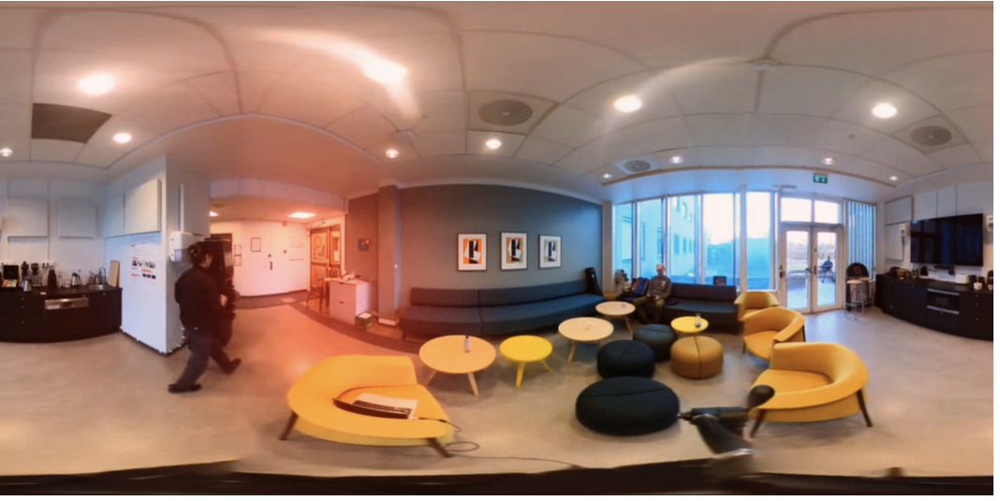

# ambiviz

[](https://github.com/astral-sh/uv)
[](https://github.com/fisheggg/ambiviz/actions/workflows/ci.yml)
[](https://pypi.org/project/ambiviz/)

Python visualization tools for ambisonic audio (and 360 video). Supports GPU acceleration with PyTorch.

## Installation

```
pip install ambiviz
```

or if you use uv:

```
uv add ambiviz
```

## Functions

### `ambiviz.anglegram()`

By default, plots the strongest direction of arrival per frame (`mode="argmax"`).
Use `mode="full"` to show all directions as azimuth and elevation heatmaps,
with the strongest direction per frame overlaid as scatter points:

```python
import ambiviz

ambiviz.anglegram("audio.wav", mode="full")
```

Full mode averages linear RMS over elevation for the azimuth heatmap and over
azimuth for the elevation heatmap, then converts to dB relative to the full
audio energy map's maximum. Both modes use `db_threshold` and `db_max` for the
color scale and hide values at or below `db_threshold`.

### `ambiviz.directogram()`

### `ambiviz.aem()`


## Gallery

### Anglegram (`plot_mode=argmax`)


### Anglegram (`plot_mode=full`)


### Directogram


### Audio Energy Map (AEM)



## References

- The core ambisonics decoder is modified from [https://github.com/pedro-morgado/spatialaudiogen](https://github.com/pedro-morgado/spatialaudiogen).
