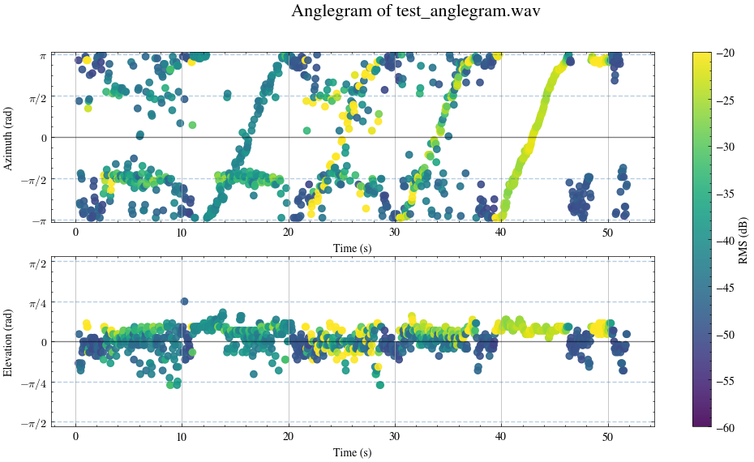
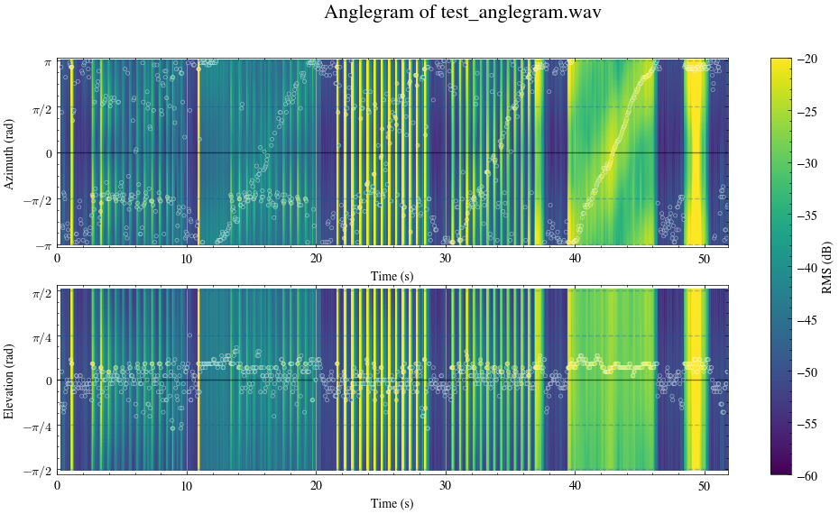
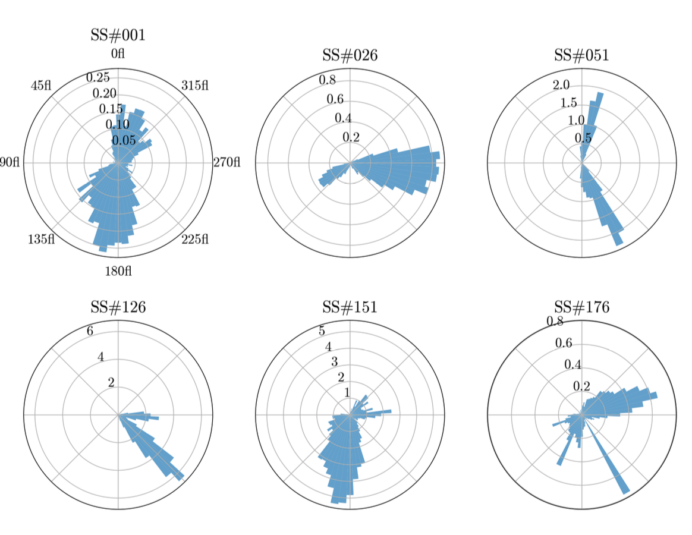
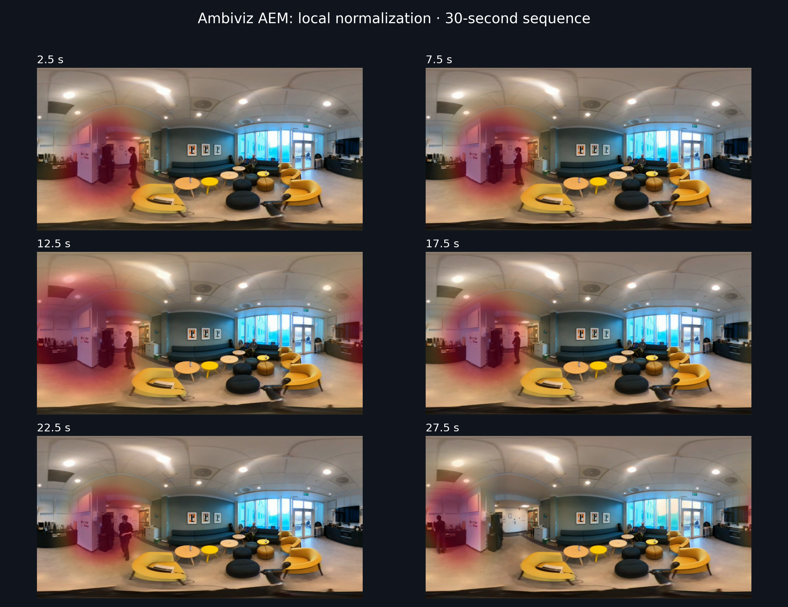

# ambiviz

[](https://github.com/astral-sh/uv)
[](https://github.com/fisheggg/ambiviz/actions/workflows/ci.yml)
[](https://pypi.org/project/ambiviz/)

Python visualization tools for ambisonic audio (and 360 video). Supports GPU acceleration with PyTorch.

## Installation

```
pip install ambiviz
```

or if you use uv:

```
uv add ambiviz
```

## Functions

### `ambiviz.anglegram()`

```python
import ambiviz

ambiviz.anglegram(
    "audio.wav",
    plot_mode="argmax" # or "full", optional
    )
```

The `plot_mode="argmax"` is the default option that only plots the DoA with maximum energy, while `plot_mode="full"` will show the energy at all directions and circles out the argmax DoA. Note that with low-order Ambisnoics, `"full"` won't have a very good spatial resolution.

### `ambiviz.directogram()`

### `ambiviz.aem()`

Blend a yellow–orange–red energy map over an equirectangular video. Stronger
directions appear redder and more opaque; weak regions keep the original video.
Maps interpolate between audio-window centers for smooth motion.

The W channel in audio will be used as a mono channel in the generated output.


```python
ambiviz.aem(
    audio_path="audio.wav",
    video_paths=["video.mp4"],
    save_path="output.mp4",
    duration=10, # optional, cut the output by sec
)
```


## Gallery

### Anglegram (`plot_mode=argmax`)


### Anglegram (`plot_mode=full`)


### Directogram


### Audio Energy Map (AEM)



## References

- The core ambisonics decoder is modified from [https://github.com/pedro-morgado/spatialaudiogen](https://github.com/pedro-morgado/spatialaudiogen).
